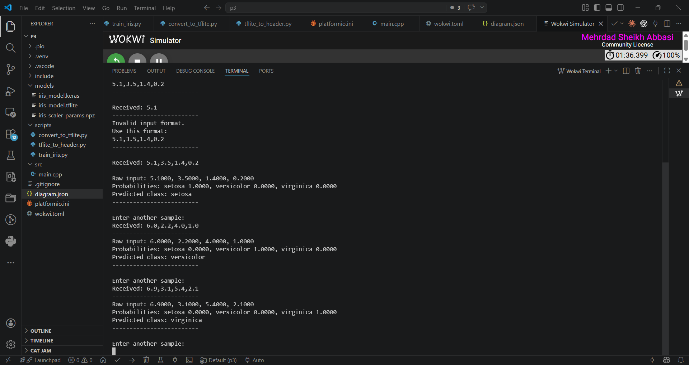

# ESP32 TinyML Iris Classifier

An end-to-end TinyML workflow that trains an Iris classifier in TensorFlow, converts it to TensorFlow Lite, embeds the model as a C array, and runs inference on an ESP32 with TensorFlow Lite Micro.

## Pipeline

```text
Iris dataset -> standardization -> Keras model -> TensorFlow Lite
             -> generated C header -> ESP32 inference
```

## Features

- Reproducible training with fixed random seeds
- Three-class neural-network classifier
- Saved normalization parameters shared with the embedded target
- TensorFlow Lite conversion and desktop inference check
- Automatic conversion of the `.tflite` model into a C header
- Serial CSV input and class-probability output on ESP32
- PlatformIO and Wokwi configuration

## Example input

```text
5.1,3.5,1.4,0.2
```

The firmware standardizes the four features, runs inference, prints the three class probabilities, and reports `setosa`, `versicolor`, or `virginica`.



## Train and export

```bash
python -m pip install -r requirements.txt
python scripts/train_iris.py
python scripts/convert_to_tflite.py
python scripts/tflite_to_header.py
```

## Build the firmware

```bash
pio run
```

To run in Wokwi, install its PlatformIO integration and use the included `diagram.json` and `wokwi.toml` files.

## Structure

```text
src/main.cpp          ESP32 inference application
include/iris_model.h  Embedded model and scaler constants
scripts/              Training, conversion, and header-generation tools
models/               Keras and TensorFlow Lite artifacts
screenshots/          Wokwi execution evidence
```

## Author

Mehrdad Sheikh Abbasi
